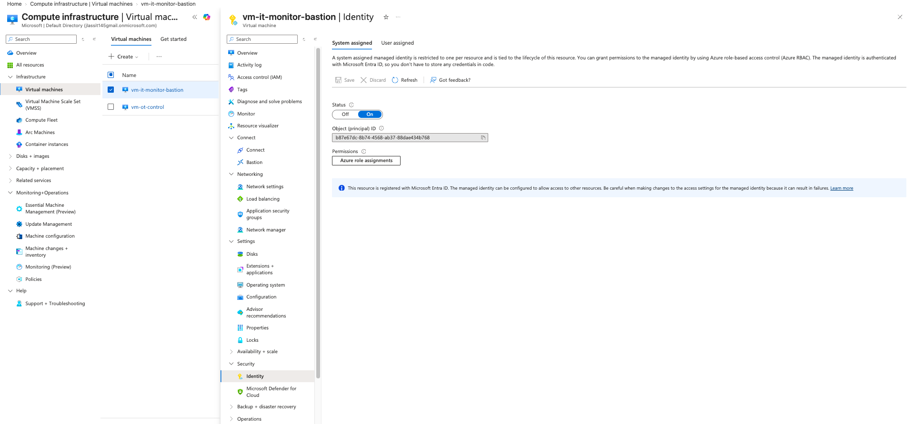
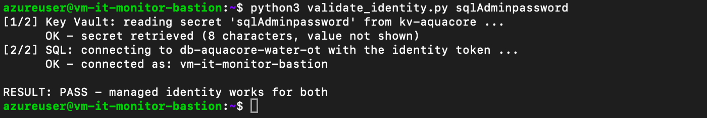
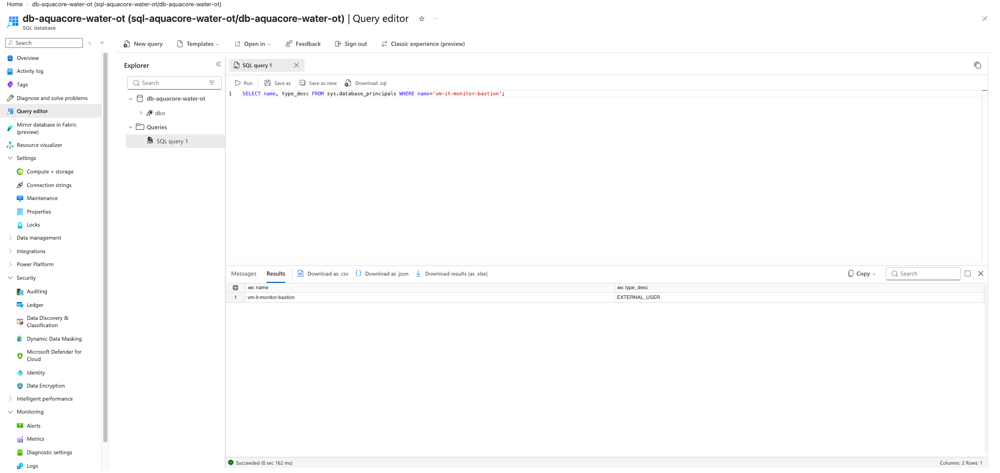
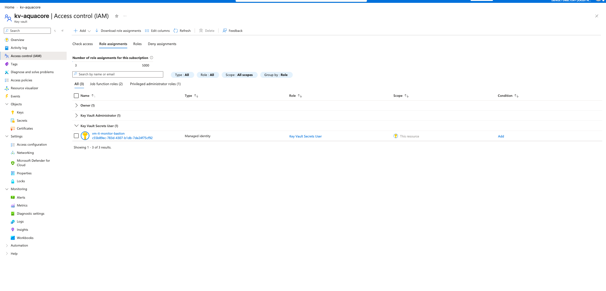
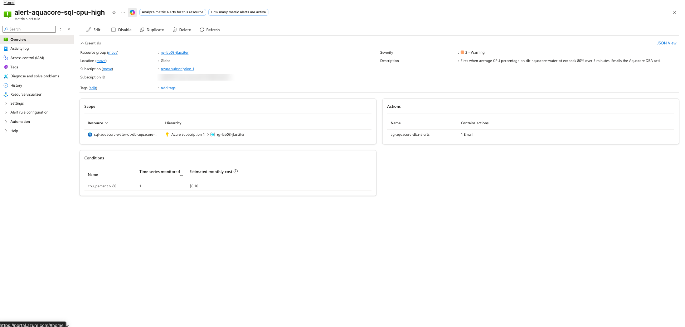
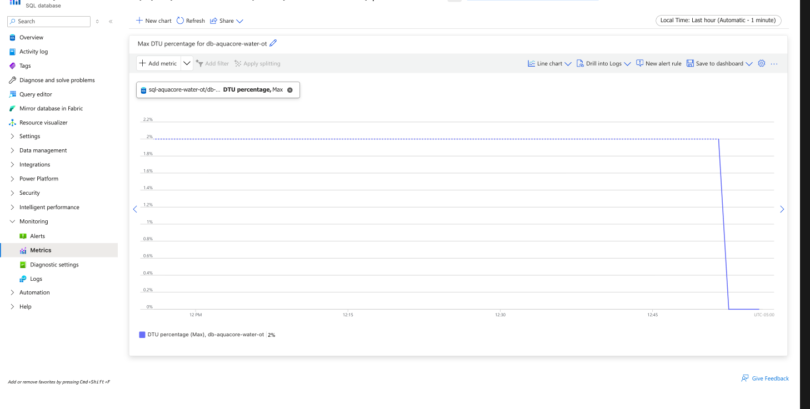

# AquaCore PaaS Lab: Azure SQL, Managed Identity, Key Vault & Monitor

Continuing the fictional **Aqua Core Solutions** water-utility scenario from [aquacore-water-ot-segmentation](https://github.com/Cybertech2005/aquacore-water-ot-segmentation).

> **Scope note:** Based on a course lab (a web-app PaaS scenario). I re-scoped it to a water-utility OT/IT scenario, added least-privilege access decisions, wrote a validation script, and documented the issues I hit. Built in the Azure portal as a learning lab, not a production deployment.


## What this proves

A VM can read a secret from Key Vault **and** query an Azure SQL Database using only its **system-assigned managed identity**. No passwords or connection-string secrets are typed into or stored on the VM. An Azure Monitor alert emails me if database load gets high.

Azure SQL Database is a PaaS offering, so Azure runs the server, patching and backups, and I only manage who can access it.

## Architecture (what was built)

| Component | Name | Purpose |
|---|---|---|
| Azure SQL Database (Basic, DTU-based) | `db-aquacore-water-ot` on `sql-aquacore-water-ot` | PaaS database |
| Key Vault (Azure RBAC) | `kv-aquacore` | Holds a secret |
| Managed identity | system-assigned on `vm-it-monitor-bastion` | Passwordless identity for the VM |
| Azure Monitor alert + Action Group | `alert-aquacore-sql-cpu-high`, `ag-aquacore-dba-alerts` | Email when CPU > 80% (5 min avg) |
| VM | `vm-it-monitor-bastion` (reused from Project 2 via `deploy.sh`) | Where the validation runs |

## How I built it

1. **Created the database.** Made resource group `rg-lab03-jlassiter`, a logical SQL server (`sql-aquacore-water-ot`), and a Basic-tier database (`db-aquacore-water-ot`) in Central US.
   *Why: PaaS means Azure runs the server, patching, and backups; I manage access and monitoring.*
2. **Created Key Vault and a secret.** Made `kv-aquacore` using Azure RBAC, stored the secret `sqlAdminpassword`, and gave myself Key Vault Administrator so I could manage it.
   *Why: the secret lives in the vault, not in code. (The SQL login itself uses the identity token, not this secret.)*
3. **Rebuilt the bastion VM and turned on its identity.** Re-ran `deploy.sh` from Project 2, then set the VM's **System assigned** identity to On.
   *Why: the identity is tied to the VM's lifecycle, so rebuilding the VM creates a new identity.*
4. **Granted the VM access to the vault.** Assigned **Key Vault Secrets User** to the VM identity and deleted a leftover "Unknown" assignment from the old VM.
   *Why: least privilege, so the VM can read secrets but not change them.*
5. **Set a Microsoft Entra admin on the SQL server.** Needed so I could create a database user for an identity.
   *Why: SQL has its own permission system, separate from Azure roles.*
6. **Created the database user.** In Query editor (Entra sign-in), ran `CREATE USER ... FROM EXTERNAL PROVIDER` and `ALTER ROLE db_datareader ADD MEMBER ...`, then verified it in `sys.database_principals`.
   *Why: least privilege, so the VM can read data but not change it.*
7. **Ran the validation from the VM.** SSH'd in, installed ODBC Driver 18 and `pyodbc`, and ran `validate_identity.py`. Both the Key Vault read and the SQL login passed with no password.
   *Why: the VM proves who it is with a token from the metadata service.*
8. **Added monitoring.** Created a CPU-percentage metric alert on the database with an Action Group that emails me.
   *Why: Azure runs the server, so I don't log into it to check on it. The alert tells me when the database is under heavy load.*

The OT control VM (`vm-ot-control`) deliberately has **no** managed identity. It has no reason to reach the database or vault, and it sits in the private OT subnet from Project 2.



## Access model (least privilege)

| Who | Resource | Role / permission | Why |
|---|---|---|---|
| VM managed identity | Key Vault | **Key Vault Secrets User** | Read secrets only |
| VM managed identity | SQL database | Contained user + **db_datareader** | Read data only |
| Me (human admin) | Key Vault | Key Vault Administrator | Create/manage the secret |
| Me (human admin)| SQL server | Microsoft Entra admin | Required to create the identity's DB user |

Key Vault and SQL have **separate permission systems**. Granting the identity Key Vault access does nothing for SQL; each needed its own grant.

SQL granted inside the database (Query editor, signed in with Entra):

```sql
CREATE USER [vm-it-monitor-bastion] FROM EXTERNAL PROVIDER;
ALTER ROLE db_datareader ADD MEMBER [vm-it-monitor-bastion];
```

## Validation

`validate_identity.py` runs on the VM. It requests tokens from the Instance Metadata Service (IMDS), then:

1. Reads a Key Vault secret (prints only its length, never the value).
2. Connects to the database with the token and runs `SELECT USER_NAME()`.

Result:

```
[1/2] Key Vault: ... OK - secret retrieved (8 characters, value not shown)
[2/2] SQL: ... OK - connected as: vm-it-monitor-bastion
RESULT: PASS - managed identity works for both
```







## Monitoring

Metric alert on the database: **CPU percentage, average, greater than 80, checked every 1 minute over a 5-minute window**, severity 2 (Warning), emailing via an Action Group.




DTU percentage chart for the database. I captured it after rebuilding the database, since the original was deleted to save cost. The database was near-idle (0 to 2%).




## Honest notes and things that went wrong

- **DTU vs CPU alert signal.** The lab called for a DTU-percentage alert. DTU % is charted on the database Metrics page (screenshot above), but the portal did not accept it when I created the alert rule, so I alerted on **CPU percentage** instead.
- **Alert not load-tested.** I confirmed the rule exists, is enabled, and points at the action group. I did not generate load to force it to fire.
- **Orphaned role assignment.** After rebuilding the VM, Key Vault showed an "Unknown" role assignment pointing at the deleted VM's old identity. I removed it and assigned Key Vault Secrets User to the new identity.
- **Wrong role first.** I initially selected Key Vault Administrator in the assignment screen and had to switch to Secrets User for the VM identity.
- **Region mismatch.** The SQL server is in Central US and the VM is in East US 2. It works, but cross-region adds latency and is not what I'd choose for production.
- **Tooling gap.** The VM's older `pip` did not support `--break-system-packages`; plain `pip3 install pyodbc` worked.

## Cost control

Basic-tier SQL Database bills while it exists, and the VMs bill while running. I delete the resource group (`rg-lab03-jlassiter`) after capturing evidence.

## What I learned

- Managed identities remove stored credentials, but each Azure service has its own authorization system.
- Azure SQL needs a database-level user mapped to the identity, not just a portal role.
- Verify the actual metric names and billing tier instead of assuming (DTU vs vCore).

## Files

- `validate_identity.py`: validation script
- `screenshots/`: evidence
